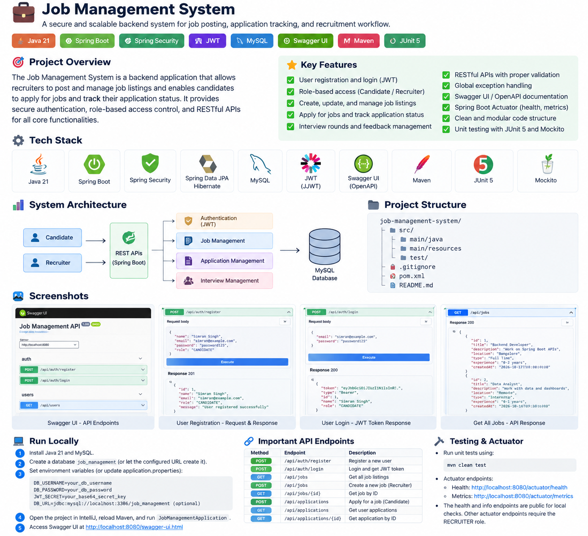

# Job Management System

A backend recruitment platform developed using Java and Spring Boot to streamline the hiring process. The system enables candidates to explore job listings and apply for positions, while recruiters can manage applications and update their statuses. It uses JWT authentication, role-based access control, and MySQL to support secure and organized recruitment workflows.



## Features

- Secure user registration and login using JWT authentication
- Role-based access for Candidates and Recruiters
- Job listings and application management
- Application status tracking and updates
- Duplicate application prevention
- Password hashing using BCrypt
- RESTful APIs with Swagger/OpenAPI documentation
- Input validation and exception handling

## Tech Stack

| Technology | Purpose |
|---|---|
| Java 21 | Backend programming |
| Spring Boot | Application framework |
| Spring Web | REST API development |
| Spring Security | Authentication and authorization |
| JWT (JJWT) | Token-based authentication |
| Spring Data JPA | Database interaction |
| Hibernate | Object-relational mapping |
| MySQL | Relational database |
| Swagger / OpenAPI | API documentation and testing |
| Maven | Dependency management and build |
| JUnit 5 & Mockito | Testing |

## Architecture

The application follows a layered backend architecture:

- **Controller Layer:** Handles HTTP requests and responses.
- **Service Layer:** Implements business logic and recruitment workflows.
- **Repository Layer:** Manages database operations.
- **Entity and DTO Layer:** Represents database entities and API data.
- **Security Layer:** Handles authentication and role-based authorization.

## API Endpoints

| Method | Endpoint | Description |
|---|---|---|
| POST | `/api/auth/register` | Register a new user |
| POST | `/api/auth/login` | Authenticate and receive a JWT |
| GET | `/api/jobs` | Retrieve available job listings |
| POST | `/api/applications` | Apply for a job |
| GET | `/api/applications/job/{jobId}` | View applications for a job |
| GET | `/api/applications/job/{jobId}/status?status=APPLIED` | Filter applications by status |
| PUT | `/api/applications/{id}/status` | Update application status |

Protected endpoints require a valid JWT Bearer token and the appropriate role.

## Getting Started

### Prerequisites

- Java Development Kit (JDK) 21
- MySQL 8
- IntelliJ IDEA
- Maven

### Database Setup

Create a MySQL database named:

```sql
CREATE DATABASE job_management;
```

### Environment Variables

Configure the following environment variables in your IntelliJ run configuration:

```text
DB_USERNAME=your_mysql_username
DB_PASSWORD=your_mysql_password
JWT_SECRET=your_base64_encoded_random_secret
```

You can optionally configure `DB_URL` if your database connection URL differs from the default.

**Security:** Use a strong, randomly generated JWT secret. Never commit database passwords or secrets to GitHub.

### Run the Application

1. Clone or open the project in IntelliJ IDEA.
2. Reload the Maven project.
3. Configure the required environment variables.
4. Run `JobManagementApplication`.
5. Open the Swagger UI URL below.

## API Documentation

Once the application is running:

- **Swagger UI:** `http://localhost:8080/swagger-ui.html`

Use Swagger UI to explore endpoints and test API requests.

## Testing

Run the test suite using Maven:

```bash
mvn clean test
```

## Spring Boot Actuator

The project configuration includes Actuator endpoint exposure for health, info, and metrics. Verify endpoint availability and permissions in your local environment before relying on them.

## Future Improvements

- Add integration tests for recruitment workflows.
- Configure and test an OAuth2 identity provider.
- Add deployment and production monitoring.

---

**Developed with Java, Spring Boot, Spring Security, JWT, and MySQL.**